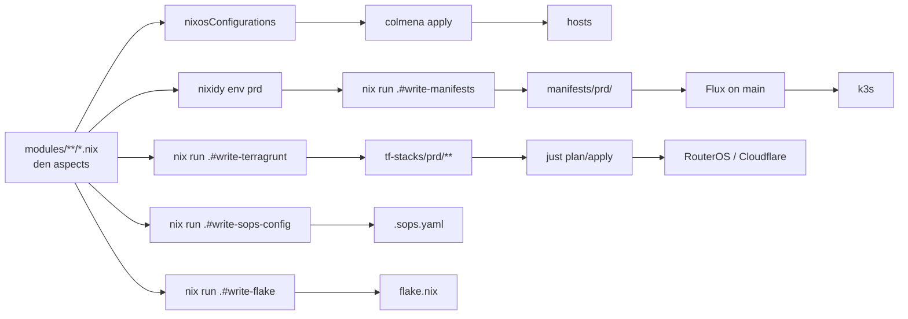

# Repository Guidelines

## Project Overview

`home-ops` is a homelab monorepo, and everything in it is generated from one Nix flake. Each den aspect is a flake-parts module under `modules/`. Those modules describe:

- NixOS hosts, deployed with colmena
- the k3s cluster `prd`, rendered to plain YAML by nixidy and applied by Flux
- RouterOS devices and cloud resources, applied with Terragrunt/OpenTofu
- secrets (SOPS for bootstrap secrets, 1Password for everything else)

Merging to `main` is a production deploy. Direct pushes to `main` are rejected, so every change goes through a PR.

## Architecture & Data Flow



- **Entry point.** `flake.nix` calls `flake-parts.lib.mkFlake` with `import-tree ./modules`, so every `.nix` file under `modules/` is a module. Files whose names start with `_` (e.g. `_ros-lib.nix`) are helpers that other files import; they are not loaded as modules.
- **Den topology.** Scopes nest as flake → fleet → environment → {network, routerosDevice, cluster, host} (`modules/den/policies/fleet.nix`). The entity schemas are in `modules/den/schema/`.
- **Quirks.** Cross-aspect channels collect values from many aspects into one place. They are registered in `modules/den/quirks/`; the main ones are `persist`, `cache`, `datasets`, `firewall`, `firewall-ports`, `generated-secrets`, `nfs-exports`, `k3s-nodes` and `bgp`. For example, `modules/den/policies/pipes.nix` gathers firewall, k3s-node and BGP data onto the RouterOS devices.
- **Aspect classes.** An aspect's content keys say what it produces: `nixos`, `k8s-manifests` or `terragrunt-stacks`.
- **Shared data.** These files are the single source of truth, so reuse them instead of hardcoding values:
    - `modules/networks.nix`: VLANs, written as `den.networks.<PascalCase>`. The CIDR is derived from `cidrBase`.
    - `modules/devices.nix`: MAC/IP registry, which feeds DHCP leases, firewall rules and colmena targets.
    - `modules/accessGroups.nix`: groups used for OAuth, POSIX and RouterOS.
- **Kubernetes defaults.** `modules/den/batteries/kubernetes/nixidy-defaults.nix` creates every Namespace (with Pod Security labels) and one Flux `Kustomization-<app>` per app. Apps can set `flux.dependsOn`, `flux.substituteFrom` and `podSecurity.namespaces`. The file also strips Helm labels and throws on non-install Helm hooks.
- **Flux.** Flux syncs the git path `manifests/prd/apps` (see `manifests/prd/flux-operator/FluxInstance-flux.yaml`). Each `Kustomization-<app>` there points at `manifests/prd/<app>/`.
- **App secrets.** Apps get secrets from external-secrets through `ClusterSecretStore` `onepassword` (1Password vault `home-ops-prd`). They are not stored in the repo.

## Key Directories

| Path | Purpose |
|---|---|
| `modules/flake/` | Flake outputs: devshell, formatter, checks, charts loader, `write-*` and `provision-*` apps, colmena, images, integration-test wiring |
| `modules/den/` | den schema, policies, quirks, and the `batteries/` for kubernetes (nixidy) and terragrunt |
| `modules/hosts/<host>.nix` | One file per NixOS host. `node1.nix` is the minimal example; `test-vm.nix` is a local VM |
| `modules/nixos/` | NixOS aspects: `base`, `disk` (ZFS/disko), `impermanence`, `services/k3s`, `users` |
| `modules/kubernetes/<app>/` | Cluster apps as `den.aspects.kubernetes.<app>.k8s-manifests` |
| `modules/clusters/prd.nix` | Cluster definition. `den.aspects.prd.includes` lists the apps that are enabled |
| `modules/routeros/*.nix`, `modules/routerosDevices/*.nix` | Shared RouterOS stack aspects, and one file per device with `terragruntInputs.<stack>` |
| `modules/users/*.nix` | `den.users.registry` entries |
| `charts/<org>/<chart>/default.nix` | Helm chart pins `{ repo; chart; version; chartHash; }`. The charts themselves are not vendored |
| `manifests/prd/` | **Generated** nixidy output, written as `<app>/<Kind>-<name>.yaml` |
| `tf-stacks/prd/{network,k3s}/**/terragrunt.hcl` | **Generated** Terragrunt units. `tf-stacks/root.hcl` keeps state in R2 |
| `tf-catalog/modules/<name>/main.tofu` | Local OpenTofu modules for the k3s stacks. RouterOS stacks use the private `kid/terragrunt-infra-catalog` |
| `secrets/` | SOPS files: `hosts/<host>/ssh_host_ed25519_key.*`, `clusters/prd/*.sops`, `cloudflare.sops.yaml` |
| `tests/integration/` | NixOS VM tests (`k3s.nix`, `impermanence.nix`) |
| `esphome/` | ESPHome configs, built and flashed by hand. Get secrets with `op inject -i secrets.tpl.yaml -o secrets.yaml` |

## Development Commands

Run `direnv allow` once; `.envrc` runs `use flake .`. The devshell then provides kubectl, helm, flux, colmena, terragrunt/opentofu, sops, age, secretspec, helmupdater, nixd/nil and other tools.

```sh
nix flake check --print-build-logs           # everything CI gates on
nix build -L .#checks.x86_64-linux.<name>    # manifests | sops-config | terragrunt | treefmt | nixos-<host>
nix fmt                                      # treefmt; also runs as a pre-commit hook

# Regenerate committed outputs (always after changing their Nix sources)
nix run .#write-manifests                    # add `-- --skip-secrets` to skip SOPS decryption
nix run .#write-terragrunt
nix run .#write-sops-config
nix run .#write-flake && nix flake lock      # after changing flake-file.inputs.*

# Charts
helmupdater update "<org>/<chart>"           # or: init | update-all | rehash
nix run .#rehash-chart charts/<org>/<chart>/default.nix
nix run .#rehash-changed-pins                # refresh hashes next to Renovate-bumped pins

# Deploy
colmena apply --on <host> [switch|boot]      # tags: env-<env>, k3s, k3s-<cluster>, k3s-server|k3s-agent
just plan tf-stacks/prd/k3s/<stack>          # also: plan-all, apply, apply-all, tf, tf-all (wraps `secretspec run terragrunt`)

# Local VM
nix build .#nixosConfigurations.test-vm.config.system.build.vmWithDisko
```

To provision a new host, use `nix run .#provision-host-key` and the nixos-anywhere wiring in `modules/flake/nixos-anywhere.nix`. Cluster bootstrap secrets come from `provision-k3s-token` and `provision-cluster-ca`.

## Code Conventions & Common Patterns

- **Never hand-edit generated files.** These are `flake.nix`, `manifests/**`, `tf-stacks/prd/**/terragrunt.hcl`, `.sops.yaml` and `.pre-commit-config.yaml`. Edit the Nix source, run the matching `write-*`, and commit the source change together with its regenerated output. A check fails if they drift.
- **Flake inputs** are declared next to the module that uses them, as `flake-file.inputs.<name>` (e.g. `modules/nixos/disk/zfs.nix`). Core inputs are in `modules/flake/inputs.nix`.
- **Module shape.** A module that takes no arguments is written `_: { ... }`. Start each file with a comment explaining why the module exists. Use `lib.`-qualified calls, the pipe operator `|>`, and `let` bindings for local constants such as pinned tags.
- **Aspect naming** follows the path, joined with dots: `den.aspects.k3s.server`, `den.aspects.disk.zfs`, `den.aspects.kubernetes.media.prowlarr`.
    - Settings are declared inside the aspect as `settings.<opt> = lib.mkOption`, and read back as `host.settings.<aspect>.<opt>`.
    - Gate optional behaviour with `host.hasAspect den.aspects.X`.
- **New host.** Create `modules/hosts/<name>.nix` and set the following (`node1.nix` is the example to copy):
    - `den.hosts.x86_64-linux.<name>` with `environment`, `system-access-groups` and `settings.*`
    - `den.devices.<name>.interfaces`
    - `den.aspects.<name>.{nixos,includes}`
    - `fleet.colmena.deployment.<name>.targetHost`
- **New Kubernetes app.**
    1. Create `modules/kubernetes/<app>/default.nix` defining `den.aspects.kubernetes.<app>.k8s-manifests = { charts, cluster, images, ... }: { applications.<app> = { namespace; helm.releases.<r> = { chart = charts.<org>.<chart>; values; }; resources.*; }; }`. `modules/kubernetes/coredns/default.nix` is a good model.
    2. Add the app to `den.aspects.prd.includes` in `modules/clusters/prd.nix`.
    3. Run `write-manifests`.
- **Cluster helpers** are available as `cluster.methods.*`: `netpol` (`mkPolicy`, `tcpUdp`, `scrapeIngress`, `apiserverEgress`), `mkAppHostname`, `mkGeneratedSecret`, `mkKopiurBackup`, `mkOidcAuth` and `mkMediaApp`. Add new ones as `den.clusterMethods.<name> = cluster: ...`.
    - Every app ships its own `ciliumNetworkPolicies`.
- **Persistence.** Root is rolled back to `zroot/local/root@empty` on every boot. To keep state, declare `den.aspects.<x>.persist.{files,directories}` (or `cache.*`); it is collected into `/persist` or `/cache`. Extra ZFS datasets go through the `datasets` quirk.
    - Never bump `system.stateVersion` (`"26.05"`).
- **Renovate pins.**
    - Put `# renovate: datasource=<ds> depName=<name>` directly above the `key = "value";` line it pins. Images may be pinned as `"tag@sha256:..."`.
    - A flake input used for manifests is pinned as `github:owner/repo/<40-hex>` inside a module.
    - Renovate ignores `manifests/**`.
- **Formatting.** treefmt runs nixfmt, deadnix, statix, hclfmt, yamlfmt (2-space indent, leading `---`), `terraform fmt` (for `*.tofu`, `*.tfvars` and `*.tftest.hcl`) and `just`. It skips `*.sops.*` and `manifests/**`. `.editorconfig` sets 2-space indent, except Markdown and justfiles (4).
- **Commits** use conventional commits with a scope, e.g. `fix(k3s-prd-0): ...`, `feat(container): update image ...`, `chore(nix): lock file maintenance`, `chore(terraform): ...`.

## Important Files

- `flake.nix` (generated) and `modules/flake/core.nix`, which imports den and flake-file and supports only the `x86_64-linux` system.
- `modules/flake/files.nix`: `write-manifests` and `checks.manifests`. It also merges `secrets/clusters/<cluster>/<ns>/<name>.sops.json` into `SopsSecret-*.yaml`.
- `modules/flake/formatter.nix`, `git-hooks.nix`, `devshell.nix`, `charts.nix`, `colmena.nix`, `images.nix`, `integration-tests.nix`, `nixos-checks.nix`, `sops-config.nix`.
- `modules/den/batteries/terragrunt/{terragrunt-stacks,devshell}.nix`: renders the Terragrunt stacks and defines `checks.terragrunt`. `write-terragrunt` does **not** delete stale leaves, so remove orphaned stack directories by hand.
- `.renovaterc.json5` and `.renovate/org-inherited-config.json5`: automerge rules, groups, and `postUpgradeTasks`. Renovate runs in-cluster from `modules/kubernetes/renovate`.
- `secretspec.toml`: credentials pulled from 1Password (`CLOUDFLARE_API_TOKEN`, `OP_SERVICE_ACCOUNT_TOKEN`, MCP tokens).
- `charts/README.md`: workflow for chart pins.

## Runtime/Tooling Preferences

- Nix flakes only, with `nixos-unstable`. There is no other package manager, and scripts are `pkgs.writeShellApplication` flake apps rather than files under a `scripts/` directory.
- Use the devshell's tool versions; don't install tools globally.
- Terragrunt always runs through `just`, which wraps `secretspec run`. Never export credentials by hand.
- Don't apply anything to the cluster with `kubectl apply`, because Flux owns cluster state. Before committing, pass the full rendered manifests to the Flux MCP `diff_kubernetes_manifest` tool for a server-side dry run.
- Custom images are Nix-built (`.#images.<name>`, `modules/flake/images.nix`). Manifests refer to them by Nix-hash tag (`.#imageRefs.<name>`), and CI pushes any missing ones with skopeo, so an image must be in the registry before its PR merges.

## Testing & QA

- **CI** (`.github/workflows/nix-flake-check.yaml`) runs only on same-repo PRs, on the in-cluster ARC runner `home-ops`. It:
    1. runs `nix flake check`
    2. pushes any missing images with skopeo
    3. posts a closure diff for `k3s-prd-0` as a sticky PR comment (informational only)
- **Flake checks:** `treefmt`, `manifests`, `terragrunt`, `sops-config`, `pre-commit`, and `nixos-<host>` (a toplevel build for each host).
- **There is no** kubeconform, `terraform validate` or `tofu test`. Manifests are validated only by diffing them against the nixidy build.
- **Integration tests** boot real VMs, take minutes, and are **not** part of `flake check`. Run them by hand when you touch k3s, disk or impermanence:

    ```sh
    nix build -L .#integration-tests.k3s-init-server   # also: k3s-server-count, k3s-renumber, impermanence-zfs-rollback
    ```

- **Adding an integration test:**
    1. Create `tests/integration/<topic>.nix`. It is a function `{ pkgs, inputs, modulesTree }:` returning an attrset of `<topic>-<case>` tests.
    2. Re-evaluate the module tree with `inputs.flake-parts.lib.evalFlakeModule`, using a fixture host that sets `intoAttr = [ ];`.
    3. Take each node's module from `config.den.hosts.x86_64-linux.<name>.mainModule`.
    4. Generate any secrets with a throwaway age key at build time. Never commit keys.
    5. Register the file with `// import ../../tests/integration/<topic>.nix args` in `modules/flake/integration-tests.nix`.
- **Minimum before a PR:** run `nix fmt`, the relevant `write-*`, and `nix flake check`. Also run the relevant integration test when changing host or k3s modules.
